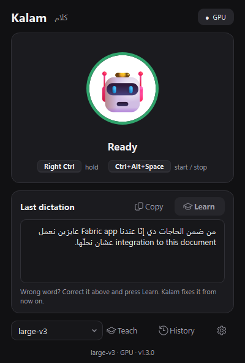
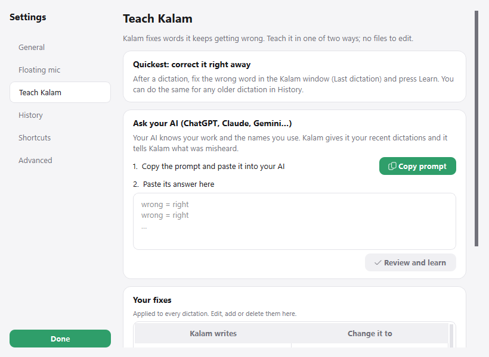

# Kalam · كلام

**Click the floating mic (or hold a key), talk the way you talk, and the text appears where your cursor is, sentence by sentence.**
Built for Egyptian Arabic mixed with English, written the way you say it: no formal Arabic, no translation.

> «محتاج أعمل update للـ dashboard قبل الـ meeting بكره»
> stays exactly like that, not «أحتاج إلى تحديث لوحة المعلومات قبل الاجتماع غداً».

Works in Word, Notion, the browser, Outlook, WhatsApp desktop: any app with a text cursor.
Everything runs on your own computer. Nothing is uploaded.

<p align="center"> &nbsp; </p>
<p align="center"></p>

## Install (Windows 10 / 11)

1. Download **`Kalam-Setup-x.y.z.exe`** from [Releases](https://github.com/datimore/kalam/releases/latest) (~520 MB).
2. Run it. No admin rights needed. Choose a desktop shortcut and *Start with Windows* if you like.
3. Open **Kalam** from the Start menu. The first start downloads the speech model
   (large-v3, ~3 GB, one time only); the window shows the progress.

An NVIDIA graphics card makes it fast (~1.5–2.5 s per sentence) and is used automatically.
Without one it runs on the processor: slower, so pick *large-v3-turbo* in the window.

Uninstall from **Settings → Apps → Kalam**.

## How to use

| Do this | What happens |
|---|---|
| Click the **floating mic** (the circle on top of every window), talk, click again | **Live mode**: each sentence lands at your cursor ~2 s after you pause |
| **Ctrl+Alt+Space**, talk, **Ctrl+Alt+Space** again | Same as the floating mic, from the keyboard |
| **Hold Right Ctrl**, talk, let go | Everything is written the moment you let go (~1 s, even for long dictations) |
| Click the big mic in the Kalam window | Start / stop; the text goes to the clipboard, ready to paste |
| **Esc** while it's listening | Cancel the rest |

- **Live caption**: while you talk, a caption at the bottom of the screen shows what Kalam hears, word by word.
  What lands in your document is the final, careful version of each sentence; nothing is ever deleted or
  rewritten in your document. Turn live mode off, or make it wait longer before a sentence ends, in Settings > General.
- **The floating mic** stays on top of everything and never takes the cursor from your document. Drag it anywhere;
  drop it on the left or right screen edge (or right-click > *Tuck into the edge*) to tuck it half-way in. It slides
  out when you hover and while it's listening.
- **Make it yours**: Settings > Floating mic > pick a look (robot, cat, camel, fox…) or **use any picture or animated
  GIF**. A ring around it shows the state: green ready, red listening, amber writing. Small / Medium / Large.
- **The Kalam window** (light and dark, follows Windows) shows the status, your last dictation, the model, and
  Teach / History / Settings. Closing it keeps Kalam running in the tray.

<p align="center"></p>

## Why it keeps your Egyptian Arabic

Generic dictation tools turn Egyptian Arabic into formal Arabic, or write English words in Arabic letters
(«داشبورد»). Kalam uses the recipe that worked for my video captions:

1. **[faster-whisper](https://github.com/SYSTRAN/faster-whisper)** running OpenAI's Whisper **large-v3** locally (GPU if you have one).
2. **Language forced to Arabic**, so a sentence full of English words isn't switched to English.
3. **A one-line prompt in Egyptian dialect, with English words in English letters**
   («كلام بالمصري، والكلمات الـ English بتتكتب English.»). Whisper copies the style of its prompt.
   Without it, English words get written in Arabic letters or dropped; a *long* prompt is worse:
   Whisper starts reusing its words and skipping parts of what you said.
4. Hint words and feeding your last sentence back are **off by default**: in testing, hint words made Whisper skip
   speech, and the last-sentence context made one mistake repeat in the next dictation. Both can be turned on in Settings.
5. **A fix list** applied after every dictation (يكذب → يكدب, الثالثة → التالتة…).
6. **Smart language**: if you dictate a sentence fully in English, it's detected and written in English.

Safety nets for Whisper's known quirks: silence and very short presses are ignored, YouTube-style phrases
it invents on silence ("اشتركوا في القناة") are dropped, and repetition loops are cut.

## Teach Kalam your words (no files to edit)

Whisper sometimes mishears a word the same way every time. Kalam keeps a list of **fixes** (wrong > right)
and applies it to every dictation. You fill it in two ways:

1. **Correct it on the spot.** In the Kalam window, fix the wrong word in *Last dictation* and press **Learn**
   (or do it for any older dictation in History). Kalam shows what it understood, e.g. «بجرّر ← بجرّب»;
   untick anything that would be a bad rule, press Learn, and it doesn't make that mistake again.
2. **Ask your AI.** Settings > Teach Kalam > **Copy prompt**. Paste it into ChatGPT, Claude or Gemini: it contains
   your recent dictations and asks your AI (which already knows your work, tools and names) for the misheard words.
   Paste its answer back, review, done.

All fixes are listed in Settings > Teach Kalam, where you can edit or delete them.

<p align="center"></p>

## Models

Pick it in the Kalam window (*Model*) or in Settings. Default **large-v3**.

| Model | Egyptian quality | Speed | Notes |
|---|---|---|---|
| **large-v3** | Best | ~1.5–2.5 s per sentence on an RTX 4060 | Default |
| large-v3-turbo | Good | Much faster | Good on slower laptops |
| large-v2 / medium | OK | Faster | |
| small / base / tiny | Weak for dialect | Fastest | Not recommended |

You can also paste any faster-whisper (CTranslate2) model id from Hugging Face, e.g. an Egyptian fine-tune.
Models download the first time you pick them.

## Settings

Everything applies instantly.

- **General**: live mode and how long a pause ends a sentence (Quick / Normal / Relaxed), language, microphone,
  filler removal, start with Windows.
- **Floating mic**: show / hide, size, look (built-in or your own picture / GIF).
- **Teach Kalam** and **History**: see above.
- **Shortcuts**: click *Set…* and press the keys. Avoid Alt+Shift (Windows language switch).
- **Advanced**: Whisper model, GPU / CPU, paste vs type, keep the mic open (never cuts your first word),
  the one-line style prompt, and two experimental options (hint words, feeding the last sentence back) that are
  off because they hurt accuracy in testing.

## Troubleshooting

- **Nothing appears in one specific app**: if that app runs *as administrator*, Windows blocks other apps from
  typing into it. Run Kalam as administrator too, or switch *Insert text by* to *type*.
- **First word missing**: start speaking a beat after pressing, or turn on *Keep mic open*.
- **Slow**: the bottom of the Kalam window says `GPU` or `CPU`. On CPU, pick large-v3-turbo.
- **Copied an image right before dictating**: paste mode can only restore copied *text*.
- **Check the whole pipeline without a mic**: `Kalam.exe --transcribe voice.wav` writes the result to `kalam.log`.
- Logs: `%APPDATA%\Kalam\kalam.log`. Downloaded models: `%USERPROFILE%\.cache\huggingface\hub`
  (not removed on uninstall; delete the `models--Systran--faster-whisper-*` folders to free the space).

## For developers

Run from source: Python 3.11+, then `install.bat` (creates `.venv`, adds GPU libraries if an NVIDIA card is found)
and `Start Kalam.bat`.
Build the exe and the installer: install [Inno Setup 6](https://jrsoftware.org/isinfo.php), then `build.bat`
(→ `installer\output\Kalam-Setup-x.y.z.exe`).

```
kalam/engine.py          faster-whisper + prompt + hotwords + fixes + hallucination filters
kalam/audio.py           mic capture, resampling to 16 kHz, optional pre-roll
kalam/inserter.py        paste / type at the cursor
kalam/app.py             hotkeys, tray, live mode (pause detection + sentence queue), worker thread
kalam/main_window.py     the mini window (Qt)
kalam/settings_window.py the settings window (General, Floating mic, Teach, History, Shortcuts, Advanced)
kalam/bubble.py          the floating mic; kalam/skins.py its looks (mic, emoji, picture, GIF)
kalam/learn.py           fixes: learn from corrections, AI prompt, read the AI's answer
kalam/overlay.py         status pill + live caption (never takes focus)
kalam/theme.py           light / dark design tokens and stylesheet
kalam.spec               PyInstaller recipe (ships only cuBLAS from the NVIDIA libraries)
installer/kalam.iss      Inno Setup script (per-user install, no admin)
tools/try_file.py        run the engine on clips of a WAV:  python tools/try_file.py voice.wav 0:6 12:8
tools/e2e.py             end-to-end: real hotkeys + paste, with a WAV in place of the mic
tools/live_sim.py        live mode end to end: real sentences + pauses streamed in real time
```

## License

MIT. Built on [faster-whisper](https://github.com/SYSTRAN/faster-whisper) (MIT) and
[OpenAI Whisper](https://github.com/openai/whisper) (MIT).
