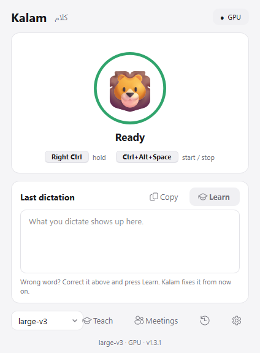

# Kalam · كلام

**Hold a key, talk the way you talk, and the text appears where your cursor is.**
Built for Egyptian Arabic mixed with English, written the way you say it: no formal Arabic, no translation.

> «محتاج أعمل update للـ dashboard قبل الـ meeting بكره»
> stays exactly like that, not «أحتاج إلى تحديث لوحة المعلومات قبل الاجتماع غداً».

Works in Word, Notion, the browser, Outlook, WhatsApp desktop: any app with a text cursor.
Everything runs on your own computer. Nothing is uploaded.

<p align="center"></p>

## Install (Windows 10 / 11)

1. Download **`Kalam-Setup-x.y.z.exe`** from [Releases](https://github.com/datimore/kalam/releases/latest) (~520 MB).
2. Run it. No admin rights needed. Choose a desktop shortcut and *Start with Windows* if you like.
3. Open **Kalam** from the Start menu. The first start downloads the speech model
   (large-v3, ~3 GB, one time only); the window shows the progress.

An NVIDIA graphics card makes it fast (~1.5–2.5 s per sentence) and is used automatically.
Without one it runs on the processor: slower, so pick *large-v3-turbo* in the window.

Uninstall from **Settings → Apps → Kalam**.

## How to use

| Do this | What happens |
|---|---|
| **Hold Right Ctrl**, speak, release | Text is inserted at the cursor ~1–2 s later |
| **Ctrl+Alt+Space**, speak, **Ctrl+Alt+Space** again | Same, for longer dictation (no key to hold) |
| Click the **floating mic** (the circle on top of every window) | Start; click again to stop. The text lands at your cursor |
| Click the **mic button** in the Kalam window | Start / stop; the text goes to the clipboard, ready to paste |
| **Esc** while it's listening | Cancel, nothing is inserted |

- **The Kalam window** shows the status, your last dictation (with a Copy button), the model picker, Settings and History.
  Closing it (✕) keeps Kalam running in the tray, so the shortcut still works. Quit from the tray icon.
- **The floating mic** stays on top of everything and never takes the cursor from your document. Drag it anywhere;
  drag it to the left or right screen edge (or right-click → *Tuck into the edge*) and it hides half-way, sliding out
  when you hover or while it's listening. Turn it off in Settings or the tray menu (*Floating mic*).
- **A small pill** at the bottom of the screen shows *Listening* (red) and *Writing…* (amber).
  It never takes the cursor away from your document.
- **The tray icon** (green mic) opens the window on click; right-click for settings, pause, start with Windows, quit.

## Why it keeps your Egyptian Arabic

Generic dictation tools turn Egyptian Arabic into formal Arabic, or write English words in Arabic letters
(«داشبورد»). Kalam uses the recipe that worked for my video captions:

1. **[faster-whisper](https://github.com/SYSTRAN/faster-whisper)** running OpenAI's Whisper **large-v3** locally (GPU if you have one).
2. **Language forced to Arabic**, so a sentence full of English words isn't switched to English.
3. **A one-line prompt in Egyptian dialect, with English words in English letters**
   («كلام بالمصري، والكلمات الـ English بتتكتب English.»). Whisper copies the style of its prompt.
   Without it, English words get written in Arabic letters or dropped; a *long* prompt is worse:
   Whisper starts reusing its words and skipping parts of what you said.
4. Hint words and feeding your last sentence back are **off by default**: in testing, hint words made Whisper skip
   speech, and the last-sentence context made one mistake repeat in the next dictation. Both can be turned on in Settings.
5. **A fix list** applied after every dictation (يكذب → يكدب, الثالثة → التالتة…).
6. **Smart language**: if you dictate a sentence fully in English, it's detected and written in English.

Safety nets for Whisper's known quirks: silence and very short presses are ignored, YouTube-style phrases
it invents on silence ("اشتركوا في القناة") are dropped, and repetition loops are cut.

## Make it understand you better

Settings → the buttons at the bottom, or the tray menu. The files live in `%APPDATA%\Kalam`
(`my-settings` when running from source). Changes apply on the next dictation; no restart.

| File | What to put there |
|---|---|
| `prompt_ar.txt` | One short line describing how you talk. Keep it short: real sentences get copied into your text. |
| `words.txt` | English terms and names you say often (only used if *Use my hint words* is on; keep it short). |
| `fixes.txt` | `wrong = right`, one per line, for words it keeps getting wrong. |
| `history.txt` | Everything you dictated, the easiest place to spot new fixes. |

## Models

Pick it in the Kalam window (*Model*) or in Settings. Default **large-v3**.

| Model | Egyptian quality | Speed | Notes |
|---|---|---|---|
| **large-v3** | Best | ~1.5–2.5 s per sentence on an RTX 4060 | Default |
| large-v3-turbo | Good | Much faster | Good on slower laptops |
| large-v2 / medium | OK | Faster | |
| small / base / tiny | Weak for dialect | Fastest | Not recommended |

You can also paste any faster-whisper (CTranslate2) model id from Hugging Face, e.g. an Egyptian fine-tune.
Models download the first time you pick them.

## Settings

- **Run on**: auto / cuda (NVIDIA GPU) / cpu. Auto falls back to CPU if the GPU fails.
- **Hold to talk / Press to start-stop**: click *Set…* and press the keys. Avoid Alt+Shift (Windows language switch).
- **Microphone**: pick a specific mic, or leave Windows default.
- **Insert text by**: *paste* (fast; your clipboard text is restored afterwards) or *type* (for apps that block paste).
- **Keep mic open**: keeps 0.4 s of audio from before you press, so the first word is never cut. The Windows mic indicator stays on.
- **Remove fillers**: drops «إممم», «ااا», "umm".

## Troubleshooting

- **Nothing appears in one specific app**: if that app runs *as administrator*, Windows blocks other apps from
  typing into it. Run Kalam as administrator too, or switch *Insert text by* to *type*.
- **First word missing**: start speaking a beat after pressing, or turn on *Keep mic open*.
- **Slow**: the bottom of the Kalam window says `GPU` or `CPU`. On CPU, pick large-v3-turbo.
- **Copied an image right before dictating**: paste mode can only restore copied *text*.
- **Check the whole pipeline without a mic**: `Kalam.exe --transcribe voice.wav` writes the result to `kalam.log`.
- Logs: `%APPDATA%\Kalam\kalam.log`. Downloaded models: `%USERPROFILE%\.cache\huggingface\hub`
  (not removed on uninstall; delete the `models--Systran--faster-whisper-*` folders to free the space).

## For developers

Run from source: Python 3.11+, then `install.bat` (creates `.venv`, adds GPU libraries if an NVIDIA card is found)
and `Start Kalam.bat`.
Build the exe and the installer: install [Inno Setup 6](https://jrsoftware.org/isinfo.php), then `build.bat`
(→ `installer\output\Kalam-Setup-x.y.z.exe`).

```
kalam/engine.py          faster-whisper + prompt + hotwords + fixes + hallucination filters
kalam/audio.py           mic capture, resampling to 16 kHz, optional pre-roll
kalam/inserter.py        paste / type at the cursor
kalam/app.py             hotkeys, tray, worker thread, single instance, start with Windows
kalam/main_window.py     the mini window (Qt)
kalam/overlay.py         the non-focus-stealing pill
kalam.spec               PyInstaller recipe (ships only cuBLAS from the NVIDIA libraries)
installer/kalam.iss      Inno Setup script (per-user install, no admin)
tools/try_file.py        run the engine on clips of a WAV:  python tools/try_file.py voice.wav 0:6 12:8
tools/e2e.py             end-to-end: real hotkeys + paste, with a WAV in place of the mic
```

## License

MIT. Built on [faster-whisper](https://github.com/SYSTRAN/faster-whisper) (MIT) and
[OpenAI Whisper](https://github.com/openai/whisper) (MIT).
